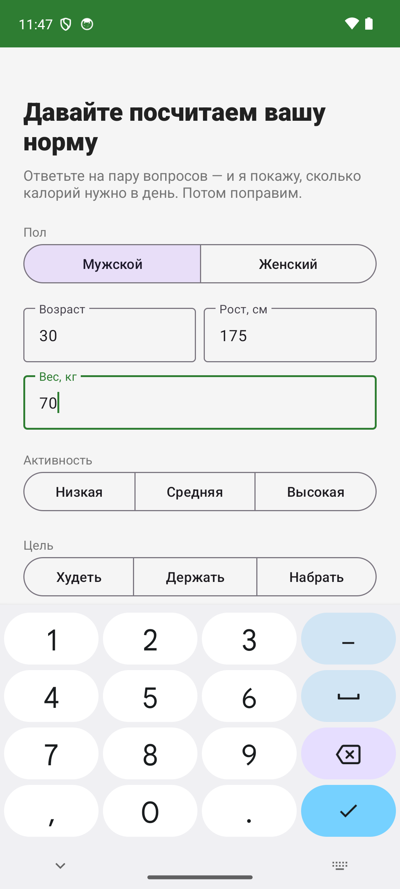
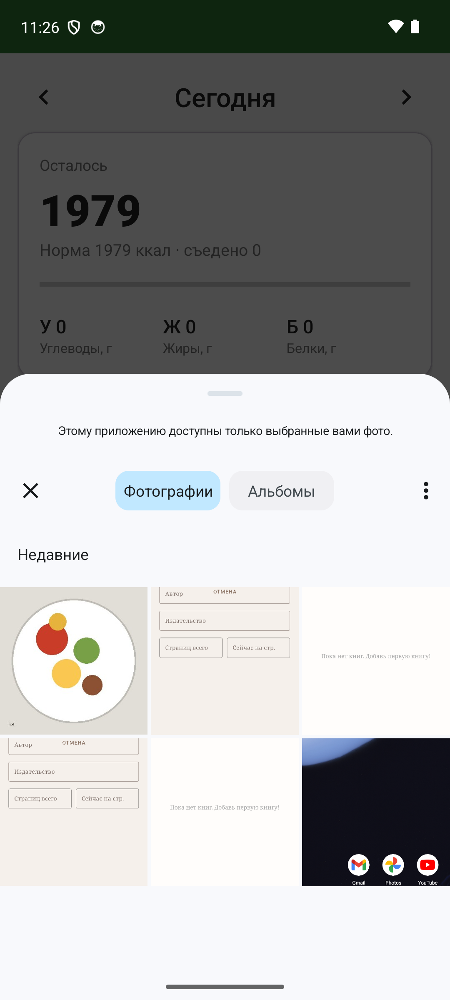

# Калории — дневник питания с распознаванием еды по фото

Android-приложение на Kotlin: считает калории и КБЖУ, распознаёт блюдо по фотографии и ведёт дневник по приёмам пищи. Хранение и вся логика — на устройстве, приложение работает офлайн (сеть нужна только для распознавания фото).

## Что умеет

- **Онбординг и норма.** Расчёт дневной нормы по формуле Миффлина — Сан Жеора (пол, возраст, рост, вес, активность), цель — худеть / держать / набрать, либо своя норма вручную.
- **Фото → КБЖУ.** Фото еды отправляется в vision-модель (OpenAI-совместимый API, DeepSeek `deepseek-flash`), ответ — оценка веса порции и макросов. Результат можно отредактировать перед записью в дневник.
- **Дневник по дням.** Свайп между днями, кольцо калорий (кастомный View), остаток/перебор, макросы Б/Ж/У.
- **Приёмы пищи.** Завтрак / обед / ужин / перекус — добавление, перенос, удаление записей с возможностью отменить действие.
- **Ручной пикер продуктов.** Поиск по локальной базе, «свой продукт», ввод на 100 г или на порцию.
- **Профиль.** Норма калорий, формула, БЖУ-раскладка, редактирование анкеты.
- **Рацион на неделю.** Каталог из 20 блюд и 34 продуктов, сборка недели локальным алгоритмом: калории дня держатся у цели, повторы не чаще двух раз, порции подгоняются под норму. Блюдо можно заменить или убрать, «приготовил» переносит его в дневник.
- **Предпочтения.** Приготовил, убрал, заменил или отложил — каждое действие пишется в журнал и сдвигает вес блюда. Планировщик учитывает вес и давность готовки, поэтому недавнее блюдо подсовывается реже, а забытое — чаще. Долгое нажатие на блюдо — «не сегодня». Экран «Что я знаю о тебе» в профиле показывает веса и позволяет поправить или удалить их.
- **Покупки.** Корзина сворачивает рацион в список по отделам: граммы, цены и итог против бюджета недели. Бюджет задаётся в один диалог и сохраняется в профиле.
- **Рецепты.** Тап по блюду в рационе открывает состав с граммовками под выбранную порцию. Шаги приготовления генерирует DeepSeek один раз и кэширует в Room, поэтому повторное открытие бесплатно и работает офлайн.
- **Продукты дома.** Отметьте продукт в корзине как «есть дома» — он исчезает из списка, сумма пересчитывается. Что уже отмечено, видно по кнопке «Дома: N».
- **Чат.** Понимает просьбы и применяет действия: бюджет, норма калорий, замена или удаление блюда, «больше не предлагать», пересборка недели.

## Покупки

- Цены живут в каталоге продуктов (`pricePer100`), стартовые — ориентир по Москве.
- Расчёт вынесен в `domain/cart/CartCalculator.kt`: чистая функция без базы, покрыта `CartCalculatorTest`.
- Корзина считается по тому же диапазону, что и рацион (сегодня + 6 дней), и обновляется сама при правках плана.
- Бюджет хранится в `UserProfile.weeklyBudget`, Room версии 4 с миграцией 3→4.

## Рецепты

- Ингредиенты и граммовки уже лежат в `dish_ingredient`, поэтому модель пишет только шаги — она не может выдумать состав или изменить вес.
- `data/remote/RecipeClient.kt` — запрос к `deepseek-flash` с отключённым thinking и `response_format=json_object`.
- `domain/recipe/RecipeParser.kt` — срезает markdown, проверяет 3-12 шагов, длину текста и таймеры; покрыт `RecipeParserTest`.
- Шаги кэшируются в таблице `recipe` (Room версии 5, миграция 4→5), поэтому второй показ бесплатный.
- Ошибка сети или невалидный ответ показываются в диалоге, а не теряются молча.

## Продукты дома

- Таблица `pantry_item` хранит, сколько грамм продукта уже есть; `CartCalculator` вычитает это из требуемого и убирает полностью закрытые позиции.
- Отметка ставится кнопкой с домиком на строке корзины, список отмеченного открывается кнопкой «Дома: N».
- Room версии 6, миграция 5→6.

## Чат

- Модель возвращает `{"reply":"...","action":null|{...}}`, а `ChatActionParser` проверяет тип действия и параметры: слот, день, суммы в разумных пределах.
- Поддержаны действия: `set_budget`, `set_target`, `replace_meal`, `remove_meal`, `exclude_dish`, `regenerate_week`.
- Действия применяет `PlanEditor` и репозитории, то есть тот же код, что и кнопки интерфейса. Модель не пишет в базу напрямую.
- История хранится в `chat_message`, рядом с сообщением лежит JSON применённого действия.
- Ошибки сети видны в чате, введённый текст не теряется.

## Рацион

Вкладка «Рацион» — стартовая. Планировщик работает офлайн и без модели: перебирает
допустимые блюда по слотам, штрафует повторы, масштабирует порции под дневную норму
и выбирает лучший из 80 сгенерированных вариантов.

- Каталог: `data/seed/SeedData.kt`, макросы считаются из ингредиентов, а не пишутся руками.
- Движок: `domain/planner/MealPlanner.kt`, покрыт тестами `MealPlannerTest`.
- Предпочтения: `domain/preferences/PreferenceEngine.kt` (события → веса), `PreferenceRepository` (журнал и снимок для планировщика).
- База: Room версии 3, миграции 1→2 и 2→3 сохраняют существующий дневник.
- ИИ здесь не участвует: он понадобится для новых блюд, рецептов и чата.

## Скриншоты

| Онбординг | Ручной пикер |
|---|---|
|  |  |

## Стек

| Слой | Технология |
|---|---|
| Язык / UI | Kotlin, View Binding, кастомные View (кольцо калорий, свайп по дням) |
| Архитектура | MVVM, ViewModel + LiveData, Repository |
| Хранилище | Room (SQLite), офлайн |
| Сеть | OkHttp + Gson, OpenAI-совместимый vision endpoint |
| Камера / медиа | CameraX, Coil |
| Навигация | AndroidX Navigation, Fragments |

## Сборка

Перед первой сборкой скопируйте пример конфига и впишите ключ vision-API:

```bash
copy gradle.properties.example gradle.properties   # Windows
cp gradle.properties.example gradle.properties     # macOS / Linux
```

Дальше обычная сборка (JDK 17+), wrapper-скриптов нет:

```bash
gradle :app:assembleDebug
# APK → app/build/outputs/apk/debug/app-debug.apk
```

Секреты и подпись задаются локально и **не попадают в репозиторий** (см. `.gitignore`):

| Файл | Что внутри |
|---|---|
| `gradle.properties` | `VISION_OPENAI_API_KEY`, `VISION_OPENAI_BASE_URL` — инжектятся в `BuildConfig` |
| `keystore.properties` | параметры release-подписи |
| `*.jks` | ключ подписи приложения |

## Планы

- Публикация в RuStore.
- Рекламная монетизация бесплатной версии (РСЯ / VK Ads).
- Уточнение КБЖУ по названию блюда через OpenFoodFacts.
